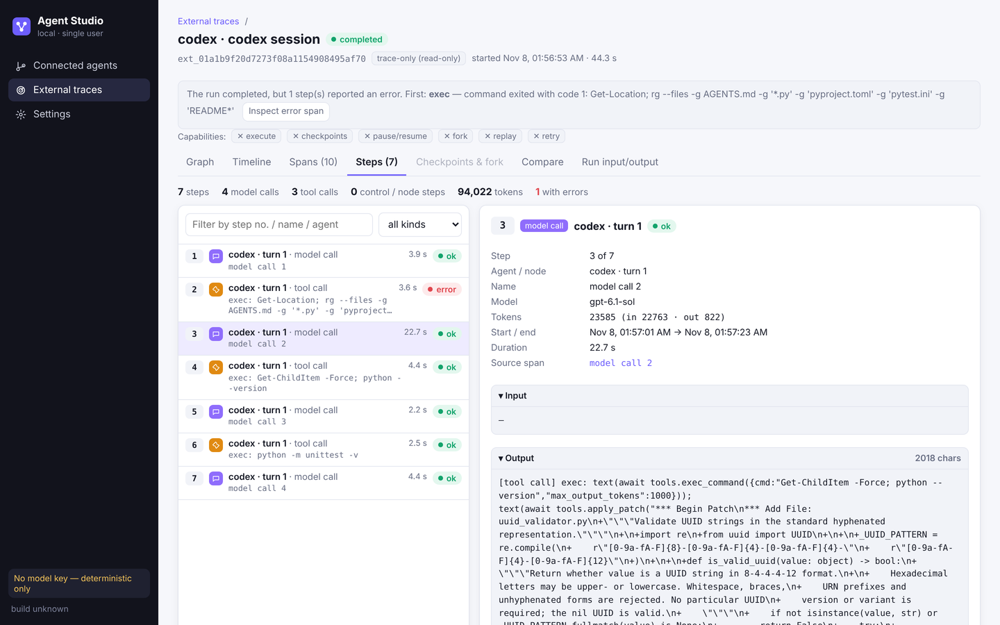

# Agent Studio（M1 Local Lab）

本地运行的**智能体调试工作台**：接入正在运行的 LangGraph 智能体，看清每一次运行走了哪些步骤，从任一检查点
**重放**或**修改后分支**，再把分支和原运行**并排对比**。别处产生的运行记录（OpenTelemetry trace、Codex 会话）也能导入查看。

> **📘 使用说明（部署、接入智能体、各功能怎么用）：[USER_GUIDE.md](USER_GUIDE.md)**



## 快速开始（任意系统，不需要模型 key，不需要 Node.js）

需要 Python 3.11。

```bash
git clone https://github.com/ezan002/m1-local-lab.git && cd m1-local-lab
python3.11 -m venv .venv                 # Windows: py -3.11 -m venv .venv
. .venv/bin/activate                     # Windows PowerShell: .venv\Scripts\Activate.ps1
pip install -e .
python -m m1_local.cli studio --demo     # 浏览器打开 http://127.0.0.1:8100
```

`--demo` 打开仓库自带的演示数据（`demo-data/` 的副本，仓库文件不会被改动），包括 M1 多智能体的真实模型运行
（qwen3:8b）、第三方 local-deep-researcher 的运行、示例外部轨迹和一份 Codex 会话转换结果。
Windows 也可以用 `.\scripts\start-studio.ps1 -Demo`。用自己的数据：去掉 `--demo`。

## 主要功能

| 功能 | 说明 |
|---|---|
| **Connected agents** | 接入在自己进程里运行的 LangGraph 智能体（M1、第三方智能体、用 SDK 包装的任意智能体），在 Studio 里发起运行、暂停、继续 |
| **运行详情** | Graph（结构与走过的路径）、Timeline（耗时）、Spans（调用树）、**Steps**（把运行拆成智能体实际做的动作，按 1..N 编号：每次模型调用、工具调用、路由判断、无调用的控制节点各一步；比节点更细，一个节点里有几次调用就拆成几步；附 span → step 对照表） |
| **Replay / Fork** | 从任一检查点原样重放，或修改这一步的输出后分支运行；检查点之前的步骤直接继承 |
| **Compare** | 分支与原运行逐节点对比：inherited / same / differs |
| **External traces** | 上传 OTLP JSON 或 Codex 会话文件，或实时接收 `/v1/traces`；只读查看 |

全部只监听本机 `127.0.0.1`，数据存在本地 SQLite。

## 文档

| 文档 | 内容 |
|---|---|
| [USER_GUIDE.md](USER_GUIDE.md) | 使用说明：部署、真实模型配置、接入智能体、各页面用法、常见问题 |
| [docs/connected-executors.md](docs/connected-executors.md) | 接入原理、检查点与 fork 规则 |
| [docs/studio-executor-sdk.md](docs/studio-executor-sdk.md) | 用 SDK 接入自己的 LangGraph 智能体 |
| [docs/advisor-qa-2026-11.md](docs/advisor-qa-2026-11.md) | 设计问题的答复与依据 |
| [docs/LEGACY_TOOLS.md](docs/LEGACY_TOOLS.md) | 之前的研究工具：本地历史轨迹观测、Who&When 归因基准、错误归因 MVP |

## 项目结构

```
src/m1_local/studio/   Agent Studio 后端（FastAPI）：存储、OTLP 导入、Codex 转换、Steps、接入的智能体
src/studio_executor/   SDK：把任意 LangGraph 智能体包装成可接入的执行器
src/m1_local/          M1 多智能体系统（LangGraph：planner → orchestrator → 工作者 → finalizer）
frontend/              界面源码（React + Vite）；打包结果在 web/studio/，运行时不需要 Node.js
examples/              示例：SDK 智能体、第三方 local-deep-researcher 接入、OpenTelemetry 外部智能体
demo-data/             演示数据（scripts/build_demo_data.py 生成，不含 token 和真实 Codex 会话）
tests/                 自动化测试（pytest）
```

## 开发

```bash
pip install -e ".[test]"
pytest tests/studio                       # Studio 测试
cd frontend && npm install && npm run build   # 修改界面后重新打包到 web/studio/
```
