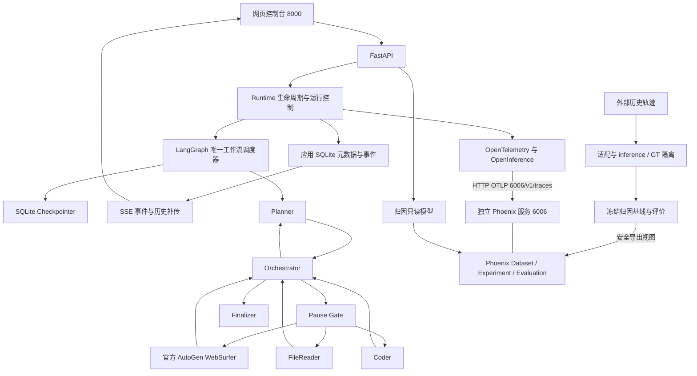

# m1-local-lab：导师项目进展汇报

核查日期：2026-09-14。代码基点：`a808a04ca60d35e6e2d35ea46441d3ba6e662597`。本轮只新增三份说明文档，不调整模型、工作流、研究协议或实验结果。

## 1. 项目名称与一句话简介

**m1-local-lab** 是一个 Windows 本地研究工具：用 LangGraph 编排受 Magentic-One 启发的工作流，用 Phoenix 记录观测与评价数据，并通过网页查看任务、检查点和外部历史轨迹的错误归因结果。

## 2. 导师原始目标与当前状态

PASS 表示表内限定范围有证据；PARTIAL 表示已实现但覆盖或产品完整度有限；NOT IMPLEMENTED 表示没有对应实现；BLOCKED 表示该项验证无法完成。历史验收与本轮执行分开记录。

| 目标 | 状态 | 当前成果与证据边界 |
|---|---|---|
| LangGraph 本地部署 | PASS | 本轮离线图执行、持久化与恢复测试通过；[graph.py](../src/m1_local/graph.py)、[runtime 测试](../tests/test_runtime_offline.py) |
| Magentic-One 风格多智能体编排 | PASS | Planner、Orchestrator、三种 Worker、Finalizer 与 Pause Gate 已接入唯一 LangGraph 调度；不是官方完整团队 |
| 官方 AutoGen WebSurfer | PARTIAL | 使用官方 `MultimodalWebSurfer`；引用既有真实测试验收，本轮未运行真实模型或浏览任务；[websurfer.py](../src/m1_local/websurfer.py) |
| Phoenix 本地观测 | PASS | HTTP OTLP、关联信息、脱敏与 flush 有本轮测试；真实接收和重启持久化引用既有验收结果 |
| checkpoint、Pause、Resume、Replay、Fork | PASS | 本轮覆盖状态、血缘、异常恢复、并发及跨进程所有权；不代表外部副作用可撤销 |
| 数据集导入与轨迹可视化 | PARTIAL | 历史适配、Dataset/Experiment 与归因时间线已实现；不是通用轨迹导入产品，也不能把导入记录恢复成本地图执行 |
| 错误归因算法 | PARTIAL | 三种冻结确定性基线和评价管线已完成；尚无有效性或泛化结论 |
| 网页控制台 | PARTIAL | 任务与归因两类页面可用；完整 Phoenix Span 浏览器未内嵌，当前浏览器整体验收仍有上游页面问题 |
| 导师电脑可部署的本地工具 | PARTIAL | 隔离 Windows 模拟部署引用既有 PASS；未在导师另一台物理电脑验收，尚无统一启动器 |
| 统一启动、完整功能只访问 8000 | NOT IMPLEMENTED | 没有 `start-all.ps1`；应用与 Phoenix 分别启动，6006 仍是高级观测入口 |

## 3. 当前总体结论

已经形成可研究、可演示的工程原型：本地任务执行链、检查点控制、观测链路、历史数据评价及归因网页都有实现和测试。当前适合交付导师进行受控本地试用；尚不应描述为完整官方 Magentic-One 部署、生产级多用户产品或已经证明有效的归因算法。

本轮完整离线回归 **130 passed、2 skipped**，两个环境 `pip check` 通过。以下五项判断不能合并成笼统的“全部完成”：

| 维度 | 判定 | 证据性质 |
|---|---|---|
| 工程回归 | PASS | 本轮执行，见第 10 节 |
| 安全 | PARTIAL | 已确认的九项 P1 修复有回归证据；仍有浏览器动作、个人信息识别等边界 |
| 新电脑部署 | PASS，仅限隔离 Windows 模拟 | 引用既有验收结果；本轮未重新安装，也没有另一台物理电脑的证据 |
| 浏览器验收 | PARTIAL | 引用既有验收结果：应用页面通过，Phoenix 外部请求报错；本轮未启动浏览器服务验收 |
| 导师可部署性 | PARTIAL | 可按现有脚本安装和双服务启动；研究数据、模型凭据与首次现场验收仍需准备 |

## 4. 当前架构图



图中的 Agent 连线展开了图内部职责，不表示另一套调度器。实际边为：START → planner → orchestrator；orchestrator 条件选择 planner、finalizer 或 pause_gate；pause_gate 条件选择 web_surfer、file_reader 或 coder；三个 Worker 均返回 orchestrator；finalizer → END。[图定义](../src/m1_local/graph.py)

## 5. 已完成模块与职责边界

| 模块 | 负责什么 | 代码与本轮测试依据 |
|---|---|---|
| FastAPI | 本地 HTTP、输入校验、Host/Origin/CSRF、静态网页、SSE | [api.py](../src/m1_local/api.py)、[test_api.py](../tests/test_api.py) |
| Runtime | 运行准入、任务状态、暂停请求、恢复、分支、关停与所有权 | [runtime.py](../src/m1_local/runtime.py)、[runtime_ownership.py](../src/m1_local/runtime_ownership.py)、[所有权测试](../tests/test_runtime_ownership.py) |
| SQLite 存储 | Checkpointer 保存图状态；AppStore 保存 run、事件、产物索引和 checkpoint/trace 关联 | [storage.py](../src/m1_local/storage.py)、[state.py](../src/m1_local/state.py)、[runtime 测试](../tests/test_runtime_offline.py) |
| 观测 | 语义 Span、关联字段、摘要和导出安全边界 | [observability.py](../src/m1_local/observability.py)、[telemetry_export.py](../src/m1_local/telemetry_export.py)、[观测测试](../tests/test_observability.py) |
| 历史适配与归因 | 历史 schema 归一化、预测/标签隔离、确定性预测、评价和安全导出 | [external_datasets.py](../src/m1_local/external_datasets.py)、[attribution.py](../src/m1_local/attribution.py)、[导出测试](../tests/test_external_export.py) |
| 归因只读页面 | 从 Phoenix 公共客户端读取 Dataset/Experiment，展示已有结果，不在 GET 请求中重算预测 | [attribution_read_model.py](../src/m1_local/attribution_read_model.py)、[对应测试](../tests/test_attribution_read_model.py) |
| Dataset 任务运行器 | 对本地任务样本执行项目工作流；与“导入外部历史”是不同入口，普通模式可能付费 | [dataset.py](../src/m1_local/dataset.py)、[test_dataset.py](../tests/test_dataset.py) |
| Windows 部署 | 两个虚拟环境、锁依赖、浏览器安装、独立服务生命周期 | [install.ps1](../scripts/install.ps1)、[安装测试](../tests/test_windows_install.py)、[launcher 测试](../tests/test_phoenix_launcher.py) |

全部自定义 HTTP 路由核对如下；同一路径不同方法分别计数，共 17 条，含首页：

| 方法 | 路径 | 用途 |
|---|---|---|
| GET | `/` | 网页首页 |
| GET | `/api/session` | CSRF 会话信息、能力与 Phoenix 入口 |
| GET | `/api/health` | 应用与 Phoenix 可达性 |
| GET / POST | `/api/runs` | 运行列表 / 创建运行 |
| GET | `/api/runs/{run_id}` | 当前状态 |
| GET | `/api/runs/{run_id}/history` | 检查点历史 |
| POST | `/api/runs/{run_id}/pause` | 请求下一安全边界暂停 |
| POST | `/api/runs/{run_id}/resume` | 恢复可恢复状态 |
| POST | `/api/runs/{run_id}/replay` | 从历史检查点创建并执行新分支 |
| POST | `/api/runs/{run_id}/fork` | 修改白名单状态后创建暂停分支 |
| GET | `/api/runs/{run_id}/events` | SSE；支持事件游标 |
| GET | `/api/runs/{run_id}/events-log` | 分页历史事件 |
| GET | `/api/runs/{run_id}/artifacts/{artifact_id}` | 指定运行的允许产物 |
| GET | `/api/attribution/summary` | 归因聚合与数据集信息 |
| GET | `/api/attribution/cases` | 案例与方法结果列表、筛选 |
| GET | `/api/attribution/cases/{dataset_case_id}` | 详情、预测、标签、评价、时间线 |

另有 `/static` 静态挂载，以及 FastAPI 默认 GET/HEAD `/openapi.json`、`/docs`、`/docs/oauth2-redirect`、`/redoc`。目前没有通用 Phoenix Trace/Span 查询接口，没有网页导入、标签编辑或启动 benchmark 的 API。

## 6. Magentic-One 风格 Agent 组成

下表“模型”指普通 `OpenAIModelGateway` 模式；测试注入的 `RuleBasedGateway` 不发模型请求。角色共用图状态，输出是状态增量，不是独立团队相互调度。

| 节点 | 输入 → 输出 | 职责与类别 | 模型 / 工具 | 位置 |
|---|---|---|---|---|
| planner | 任务、允许文件、既有状态 → facts/unknowns/plan、账本 | 模型驱动规划角色，同时是图节点 | 是；无独立外部工具 | [graph.py](../src/m1_local/graph.py)、[models.py](../src/m1_local/models.py) |
| orchestrator | 计划、任务/进度账本、预算 → 路由、指令、重规划或结束 | 模型驱动协调角色；受图条件边约束 | 正常路径是；预算终止可不调用 | 同上 |
| pause_gate | 当前运行、暂停请求 → interrupt 或进入 Worker | 普通控制节点，不是 Agent | 否；读取本地运行存储 | [graph.py](../src/m1_local/graph.py) |
| web_surfer | Worker 指令、分支浏览器上下文 → 文本、引用、截图、进度 | 官方 AutoGen Worker Agent 的封装 | 是；Playwright/Chromium 和网络 | [websurfer.py](../src/m1_local/websurfer.py) |
| file_reader | 显式允许的文件路径 → 文件内容摘要、进度 | 普通确定性工具节点 | 本节点否；读白名单内 txt/md/csv，限制大小 | [graph.py](../src/m1_local/graph.py)、[security.py](../src/m1_local/security.py) |
| coder | Worker 指令 → Markdown 代码产物、进度 | 模型驱动生成角色 | 是；写本地产物，不执行生成代码 | [graph.py](../src/m1_local/graph.py) |
| finalizer | 任务、证据、引用、状态 → 最终回答与终态 | 模型驱动总结角色 | 正常路径是；失败/预算路径可本地收尾 | 同上 |

没有实例化官方 `MagenticOneGroupChat`；没有 ComputerTerminal；FileReader 不等于官方 FileSurfer，不支持通用 PDF/Office 导航；Coder 不安装或运行生成代码。官方组件是 AutoGen 0.7.5 的 `MultimodalWebSurfer`，其团队级管理被本项目的 LangGraph 规划、协调和条件边替代。不能将七个图节点称为七个官方 AutoGen Agent。[依赖与入口](../pyproject.toml)

## 7. LangGraph 与 Phoenix 的融合方式

应用通过 Phoenix OTel SDK 注册 tracer，向 `http://127.0.0.1:6006/v1/traces` 发送 HTTP/protobuf OTLP。OpenInference 为根运行标记 AGENT，为控制链和 checkpoint commit 标记 CHAIN，为 Worker 标记 TOOL，为模型调用标记 LLM；LangChain/OpenAI instrumentation 捕获相应 SDK 调用。离线测试中的 LLM 语义 Span 不等于调用了真实模型。

`run_id` 标识应用运行，`thread_id` 标识图线程，`branch_id` 标识分支，`execution_id` 区分每次节点执行；一次完整图执行包含多个节点 execution_id。checkpoint 以 thread/namespace/id 定位，真实提交后产生 `m1.checkpoint.commit` 并存入关联表。`trace_id` 标识某次观测树，同一 run 在 Resume 后可以有多个执行尝试和 Trace；页面主要提供最新 Trace ID。[runtime](../src/m1_local/runtime.py)、[存储](../src/m1_local/storage.py)、[关联测试](../tests/test_observability.py)

Pause 是在安全控制节点响应请求，不强制中断正在进行的外部调用。Resume 继续既有 run；Replay 在同一 thread 下建立新 run/branch 并执行；Fork 仅允许调整 plan 和 worker_instruction，创建暂停的新分支，之后 Resume。旧分支 head 不移动，血缘保留。Phoenix 只展示这些关联，**不负责 LangGraph 回滚**；浏览器 URL/摘要的恢复也不是浏览器 DOM、登录会话或外部副作用的完整快照。[控制回归](../tests/test_runtime_offline.py)

Phoenix 另承担 Dataset、Experiment、Evaluation：历史导入保存来源与安全展示视图，归因 Experiment 保存预计算预测，Evaluation 保存正确性、覆盖和可评分状态。SDK 实验产生的观测记录是本地适配/评价过程，不是重新执行了外部 Agent。

安全措施包括模型原始输入输出隐藏、凭据形态过滤、异常信息安全导出，以及 `safe-export-v1` 深拷贝。需要保持语义的标签、身份、版本等字段若命中敏感信息，会拒绝导出，而非悄悄改变研究输入。已有 Phoenix 数据库不会被追溯清洗；这些规则不是完整个人信息识别，运行 State、文件和截图也不能视为可公开材料。[导出实现](../src/m1_local/external_export.py)、[导出测试](../tests/test_external_export.py)

根 Span 结束后执行 flush；失败不会令主工作流必然失败，但没有离线可靠队列或必达保证。Phoenix 不可达时健康信息显示降级，任务可继续；归因读取会返回可恢复的服务不可用错误。`/api/health` 的 HTTP 200 不能单独证明 Phoenix 接收到 Span。

Phoenix 仍需独立后台进程和独立虚拟环境。项目 wrapper 针对锁定的 Phoenix 11.35.0 禁用了未使用的 gRPC，上游横幅显示 4317 不代表实际监听；支持的入口应只监听回环 6006。应用需要另行启动，8000 主页面只提供 Trace ID 与 Phoenix 跳转，6006 仍是完整 Trace/Span 的高级入口。**统一启动、完整观测内嵌和只访问 8000 尚未完成。** [serve_phoenix.py](../scripts/serve_phoenix.py)

## 8. 网页 UI 已实现功能

一级标签页是“任务运行”和“错误归因”；任务详情下有事件、证据、Checkpoint、State。下表“已实现并验证”包括本轮 API/行为回归或明确的既有浏览器证据，不表示本轮逐项进行了真实浏览器点击。[HTML](../web/index.html)、[JavaScript](../web/app.js)、[样式](../web/style.css)

| 操作 | 状态 | 核实范围与限制 |
|---|---|---|
| 新建任务 | 已实现并验证 | API 校验、CSRF 与 UI 提交；普通入口可能调用付费模型 |
| 历史任务 | 已实现并验证 | 本地 AppStore 运行列表；与导入的历史案例分开 |
| SSE 实时事件 | 已实现并验证 | 游标补传、去重、选择切换、分页尾部补齐和终态关闭；[前端行为](../tests/frontend_behaviors.cjs)、[runtime 测试](../tests/test_runtime_offline.py) |
| Planner/Orchestrator/Worker/Finalizer 状态 | 已实现并验证 | 四组可视状态，不是七个节点的完整独立图编辑器 |
| 输出 | 已实现并验证 | 最终回答或最新消息；completed 不等于事实正确 |
| 引用 | 已实现但部分验证 | 根据现有 state 展示 HTTP(S) 引用；本轮没有生成真实浏览引用 |
| 截图 | 已实现但部分验证 | 有产物才显示预览；本轮未运行 WebSurfer 截图链路 |
| 产物 | 已实现并验证 | 产物索引及安全访问；Coder 明确为未执行产物 |
| checkpoint | 已实现并验证 | 列表、next、状态等摘要；历史选择不等于任意编辑状态 |
| State JSON | 已实现并验证 | 当前运行完整 state；并非选中历史 checkpoint 的任意完整快照浏览器 |
| Pause | 已实现并验证 | 安全边界暂停有确定性测试；快速离线任务不保证来得及现场点击 |
| Resume | 已实现并验证 | 状态限制和恢复测试；已完成运行不能 Resume |
| Replay | 已实现并验证 | 初始化后的可继续检查点；新 run/branch，不修改旧 head |
| Fork | 已实现并验证 | plan/worker_instruction 白名单，新分支先暂停 |
| Trace ID | 已实现并验证 | 本地关联表的最新 ID、复制功能 |
| Phoenix 跳转 | 已实现但部分验证 | 真实 popup 已打开；其 GitHub 请求报错导致整体 PARTIAL |
| 错误归因概览 | 已实现并验证 | 默认 MVP 案例集与有限聚合指标；不是完整 30 样本 benchmark 仪表盘 |
| 方法与其他筛选 | 已实现并验证 | 方法、来源、评价状态、截断；正确性还有 API 筛选参数 |
| 样本详情 | 已实现并验证 | 按案例与方法查看，支持空结果与服务错误 |
| Prediction | 已实现并验证 | 已存预测、解释与状态，不在浏览时运行 predictor |
| Ground Truth | 已实现并验证 | 独立展示标签；标签不进入 predictor 接口 |
| Evaluation | 已实现并验证 | match、distance、coverage、可评分性等；不得混淆分母 |
| 时间线 | 已实现并验证 | 保留步骤、预测/标签位置；缺失或截断显示限制 |
| Dataset/Experiment 信息 | 已实现并验证 | 当前读取来源与已有实验信息；不是网页创建/管理平台 |
| 主网页完整 Trace/Span 查询 | 未实现 | 需跳转 Phoenix 6006 |

浏览器覆盖为**引用既有验收结果**：早期归因 UI 使用 1366×768、1920×1080、1536×864（后者 device_scale_factor=1.25），并验证一次预期 503 的恢复。这不是 Windows 系统缩放或真实浏览器页面缩放的完整矩阵。最近隔离验收使用 Chromium 1181、1366×768、默认 scale；应用 console error、page error、request failure 为 0，整体意外 4xx/5xx 为 0。Phoenix popup 的 GitHub 星标请求被隔离策略阻止，产生各 1 个 console/page/request 错误，验收脚本退出 1，整体 PARTIAL；不能写成浏览器 BLOCKED 或整体 PASS。[UI 验收器](../scripts/verify_attribution_ui.py)、[隔离验收器](../scripts/verify_advisor_release.py)、[历史回执说明](full-project-audit-optimization.md)

## 9. 数据集与错误归因进展

### 数据来源和范围

| 数据 | 用途 | 已有获取与使用范围 | 许可边界 |
|---|---|---|---|
| TraceElephant / Magentic-One | 验证一种外部执行日志的适配、来源标注、截断和展示 | 既有 bounded Range smoke：约 1,038,147 字节传输，保留一例的 meta/steps 两个 JSON；没有全量约 596.6 MB ZIP。该例原 31 步、保留 20 步 | 项目固定来源记录为 CC BY 4.0；不能推导全部嵌入内容已无敏感风险 |
| Who&When smoke | 与另一 schema 对照，覆盖手工/算法生成历史 | 初期两例 JSON；是三案例 MVP 中的两例 | 仅本地研究；代码仓库 MIT 不等于数据集授权 |
| Who&When benchmark v1 | 固定协议的可复现基线评价 | 后续已有两份 Parquet，共 184 行，记录下载 1,903,897 字节；从中固定选择 30 例。不是“只下载了 30 例” | 不授权再分发原始数据；交付源码不附带研究数据库或原始文件 |

以上传输数字**引用既有验收结果**，本轮下载 0 字节。只读目录清点与现状一致：TraceElephant 两个 JSON，早期 Who&When 两个 JSON，后续 `who_when` 目录两份 Parquet 及派生 JSON；本轮未打开研究数据库或重跑全量 benchmark。[smoke 记录](external-dataset-smoke.md)、[benchmark 协议](attribution-benchmark-v1.md)、[manifest](../datasets/manifests/who_when_benchmark_v1.json)

固定 Who&When dataset revision 为 `59b9fcba1aaed7bbf206b5f4d3c68b8face2f49c`，repository revision 为 `b2bae5c5b06d681d04ea5e9b63b7a30525c04925`。TraceElephant smoke 的 HF revision 为 `a78a57cdcdf74a080b1bec0f56f85228d86acbac`，repository revision 为 `0ce8abb2855de9f454f27f6b0795a4b7e6c8d5fc`。Manifest、来源文件哈希、固定选择种子与协议摘要约束输入。TraceElephant 采用自身 step_id/agent_name；Who&When 采用历史数组的零基索引与原 name/role，不能擅自统一成某个 Agent 名称或修正标签偏移。

### 隔离与三种方法

Adapter 输出来源、版本、任务、历史及标签；构造不可变 inference view 时隔离 responsible_agent、decisive_step、failure_reason 等标签字段，predictor 只接收 inference，评价器之后才使用 Ground Truth。任务 expected_answer 可以存在于 inference，并不等于归因标签。递归字段防漏不是对自然语言暗示的完整证明。[attribution.py](../src/m1_local/attribution.py)、[归因测试](../tests/test_attribution.py)

三种基线是 `last_active_agent`（最后有效参与者）、`first_explicit_error`（首个显式错误，否则 abstain）、`rule_based`（固定错误/重试等权重与稳定 tie-break）。没有训练或新增模型；confidence 是规则值，不是校准概率。冻结源码基点为 `da3ef193bdd73474eec5191f1e267ee163c308a7`。

30 例包括 Hand-Crafted 10、Algorithm-Generated 20；Dev 20（7+13），Frozen Test 10（3+7）。通过 schema 合法性检查后按固定哈希选择与拆分，不根据分数挑样。**Frozen Test 的基线结果已经查看过，不能称为从未查看的严格盲测集。** Agent 比较仅规范化字符、空白与大小写；步骤采用零基非负整数，不搜索“最有利偏移”。[冻结协议](../configs/attribution_eval_v1.json)、[协议实现](../src/m1_local/attribution_protocol.py)

### 固定结果与分母

下表是本轮只读核对已有聚合 JSON，**引用既有验收结果，不是本轮重新运行 30×3 benchmark**。[聚合结果](results/attribution-benchmark-v1-summary.json)

| 方法 | Agent exact | Step exact | 预测覆盖 |
|---|---|---|---|
| last_active_agent | 10/30 | 0/29 | 30/30 |
| first_explicit_error | 3/30 | 3/29 | 16/30 |
| rule_based | 3/30 | 3/29 | 30/30 |
| 合并描述统计 | 16/90（17.78%） | 6/87（6.90%） | 76/90（84.44%） |

合并 joint exact 为 5/87；step±1 为 16/87，±2 为 20/87；距离只在 74 个有效数值预测对上定义，总距离 851，均值 11.50、中位数 4。Selective agent 为 16/76、selective step 为 6/74。一个案例步骤标签不在保留历史中，所以三种方法各排除一个 step 分母，Agent 分母仍为 90。Abstain 在可评分 accuracy 分母内计错，不用跳过弃答来提高 accuracy；distance 与 selective 的分母不同。[评价实现](../src/m1_local/attribution_benchmark.py)

`truncated=false` 只表示未删步骤，字符串/结构仍可能被限制长度。步骤标签缺失、越界或被裁掉时是 unscorable，而不是随意计错或映射到别的步骤。TraceElephant MVP 的 31→20 步截断并不自动令所有指标不可评分，其标签步骤仍在保留范围。

Phoenix 保存内容的历史证据：MVP 三例 × 三方法 = 9 个预测 run、72 条 Evaluation；benchmark 30 例 × 三方法 = 90 个 run、1,170 条 Evaluation（13 种）。这些是**导入历史的离线预测/评价**，有 `trace_origin=imported_historical`、`executed_by_m1_local=false`、`external_task_executed=false`。本轮未查询当前 Phoenix 实例确认这些记录仍存在；全新部署也不会自动拥有它们。

目前结果说明输入隔离、固定预测、分母计算和展示管线可以工作。30 例规模、确定性启发式、异质 Agent 名称、人工标签限制与已查看的 Frozen Test 都不支持算法有效性或泛化结论；三个方法的合并 90 行也不是 90 个独立样本。

## 10. 关键测试与验收证据

| 验证 | 本轮结果 | 说明 |
|---|---|---|
| 完整离线 pytest | 130 passed、2 skipped，68.72 秒，退出 0 | 132 项收集；隔离临时数据，禁用真实模型、清空本进程 Key、禁用 LangSmith |
| 首次沙箱运行 | 129 passed、2 skipped、1 failed，98.80 秒 | 唯一失败是 Node `spawn EPERM`；授权后原套件重跑通过，没有通过删除测试或增加 skip 获得 PASS |
| 两个虚拟环境 pip check | 两者退出 0，无依赖冲突 | 原应用与 Phoenix 环境；不是本轮新电脑重装 |
| Python AST | 51 个文件通过 | src/scripts/tests，内存解析，不生成 pyc |
| API、前端、安全回归 | 纳入完整离线套件通过 | API TestClient、Node 行为模拟；不冒充本轮真实 Chromium 验收 |
| 冻结资产 | 10 个受保护文件与 `1c1441c` 无差异 | 包括图、模型、原归因源码、协议、manifest、结果和两份 lock |
| 当前跟踪文件安全检查 | 80 个文件，未确认真实凭据；无禁止路径及超过 1 MiB 文件 | 命中人工审阅为脱敏测试哨兵、正则或配置变量引用；模式扫描不保证发现全部秘密 |
| 新文档检查 | 相对链接、命令、Markdown 结构、敏感模式、大小及空白检查 | 检查过程不执行文档中的安装/服务命令 |

文档质量核验：三份文档的 21 个 Markdown 表格已由本机现有 MarkdownIt 解析并生成 HTML，22 段 PowerShell 均通过语法解析。Mermaid 采用标准 flowchart 语法，已核对节点、边与代码块结构；本机没有找到可用的独立 Mermaid 渲染器，在禁止新增下载的范围内，**实际 SVG 渲染验证 BLOCKED**，没有将结构检查称为浏览器渲染通过。

完整回归可在仓库根目录复现；下面命令使用新的系统临时测试路径，不读取现存 Phoenix 数据库：

```powershell
$env:RUN_REAL_MODEL_TESTS = '0'
$env:OPENAI_API_KEY = ''
$env:LANGSMITH_TRACING = 'false'
$env:PYTHONDONTWRITEBYTECODE = '1'
$env:PYTEST_ADDOPTS = ''
$TestRoot = Join-Path $env:TEMP ('m1-docs-tests-' + [guid]::NewGuid().ToString('N'))
& '.\.venv\Scripts\python.exe' -B -m pytest -q -rs -p no:cacheprovider --tb=short --basetemp "$TestRoot"
```

本轮 JUnit 回执保存在系统临时验证目录的 `pytest-elevated.xml`；不把个人绝对路径写入交付文档。两项 skip 均来自 [test_real_websurfer.py](../tests/test_real_websurfer.py)，要求显式 `RUN_REAL_MODEL_TESTS=1`、真实模型访问与计费调用。它们不构成本轮通过的真实模型证据。

**引用既有验收结果**：隔离 Windows 使用新双环境、无原 data/数据库/缓存；应用 130/130、Phoenix 77/77 锁依赖匹配。Phoenix 补齐安装实际 84.375 秒、退出 0、无超时；健康检查和 RuleBased 文件任务通过，27 个 Span 在 Phoenix 重启后仍存在。完整浏览器结果为 PARTIAL，见第 8 节。本轮未重装、未启动服务、未查询或写入 Phoenix 数据库；任务前后 4317、6006、8000、8001 无监听。[既有验收说明](full-project-audit-optimization.md)

2026-08-28 的两项真实 WebSurfer 测试只能引用为历史验收，不能替代审查后全链路真实模型验证；既有真实图回答质量也存在不完整之处。[acceptance.md](acceptance.md)

## 11. 当前演示能力

可以用项目现有 RuleBased 验收入口展示真实本地文件读取、图运行、事件、检查点、Replay/Fork 和观测关联；输出明确标为离线确定性占位总结。Coder 演示生成未执行产物。文件演示不会产生浏览器截图或网页引用，应展示真实空态，不伪造证据。

归因演示优先使用既有、允许本地展示的 Who&When 与 TraceElephant 样本；全新源码包没有这些数据库内容。只有合成 fixture 时，必须注明“本地合成”，不能称为已经导入的真实研究样本。具体步骤、备用方案与 5/15 分钟脚本见 [演示指南](demo-walkthrough.md)。

## 12. 当前限制

本工具为回环地址、单用户、受控运行设计，没有多用户认证与远程共享隔离。跨进程锁只约束遵守同一协议的 runtime，不阻止其他程序直接修改 SQLite。重启可标记中断并恢复检查点，但不能保证外部操作 exactly-once 或撤销浏览器副作用。

WebSurfer 有导航白名单、非公共地址限制与禁下载措施，但 HTTP method、DNS 变化、service worker、表单和上传等动作边界尚未完整验证；这是风险建议，不能因九项 P1 已关闭就宣称全部解决。模型调用计数包括测试 gateway，且 WebSurfer 内部调用不完全等同该计数，不能把配置预算当作严格费用上限。

Phoenix wrapper 依赖锁定版本内部入口，版本不兼容会拒绝启动。Phoenix GitHub 星标组件仍可尝试外部请求，`PHOENIX_ALLOW_EXTERNAL_RESOURCES=false` 不是出站防火墙。导出过滤不追溯清理历史数据库，也不保证任意个人信息匿名化。

部署依赖完整源码与 `web/`，不是已经验证的独立 wheel 产品；锁版本不等于所有包都做了哈希校验。研究数据库、原始数据、截图、日志和本机配置不随源码交付。

## 13. 尚未完成的内容与旧文档差异

未实现：统一启动器、完整 Phoenix Trace/Span 主页面、通用历史导入管理、网页 benchmark 管理、多用户产品、ComputerTerminal、完整 FileSurfer、可靠外部副作用回滚。它们是能力范围说明，不是本轮承诺开发的清单。

| 旧材料表述 | 当前证据与解释 |
|---|---|
| README 的安全限制仍称缺少跨进程所有权、gRPC 通配监听未修复 | [runtime_ownership.py](../src/m1_local/runtime_ownership.py)、[serve_phoenix.py](../scripts/serve_phoenix.py) 与对应回归已修复这两个已证实问题；更广风险仍保留 |
| 审查报告尾部 Phoenix 安装 BLOCKED、107 项通过、22 个未提交路径 | 这是早期快照；报告顶部续接段已更新安装与 130 项回归。当前成果已提交到 a808a04，不能照抄尾部为当前状态 |
| 审查报告顶部仍描述提交前 HEAD/39 个工作区路径 | 当前 Git 为 a808a04，开始时 clean；本轮仅新增三份文档 |
| 早期 external smoke 只下载两例 Who&When、没有 Parquet/归因 UI | 属于当时阶段；后续已有固定 Parquet 与 30 样本协议、归因 UI |
| 界面“完整保留”或“轨迹”容易被理解为完整原始执行 | 步骤未裁掉不代表字符串未截断；历史导入不等于本地执行 |

本轮保留历史文档原样，以本报告明确时间和范围，避免把历史记录改写成没有发生过失败。

## 14. 下一阶段建议

1. **导师物理电脑验收**：按双服务指南、零费用 fixture 完成可重复安装/启动/停止；独立记录浏览器外部请求问题，明确真实数据交付边界。
2. **产品入口整合**：另行设计统一启动、健康等待、停止所有权和观测入口；将 Phoenix 外部资源问题纳入验收。这是建议，不是已完成实现。
3. **下一版研究设计**：保留现有 v1 不变，先约定新算法目标、数据权限与未查看评估集，再做误差分析和新的版本化比较；不能为提高既有分数调整 v1。

## 15. Git、tag 与发布状态

当前分支 `feature/full-project-audit-optimization`，HEAD `a808a04ca60d35e6e2d35ea46441d3ba6e662597`。本轮开始时工作树 clean；交付时只新增三份 Markdown，未暂存、未提交。`git remote -v` 为空，没有可提供的现成远程 clone URL；未 push。

| annotated tag | refs/tags 对象 SHA（类型 tag） | 解引用 commit（均为 HEAD 祖先） |
|---|---|---|
| m1-local-lab-v1.0-smoke | `5a0fe38cdd7445f0a72638d1bbc04ccd300e14ef` | `71cc37e740be9a755261f1c9153aca22b19eec09` |
| m1-local-lab-v1.1-attribution-ui | `74de81bf81ca1f284c7f48c006285e414d82ec2c` | `f9c6a4fa4f6ba9970a7e67596ac3c734c6d5e44e` |

对象 SHA 与最终 commit SHA 的区别来自 annotated tag 解引用，不是当前证据中的移动；本轮未操作任何 tag。相关历史：

```text
a808a04 fix: harden runtime security and Windows portability
1c1441c feat: add attribution benchmark protocol v1
f9c6a4f feat: add failure attribution visualization
da3ef19 feat: add offline failure attribution MVP
71cc37e feat: complete local Magentic-One observability and dataset smoke MVP
```

## 16. 文档索引

- [Windows 部署指南](windows-deployment-guide.md)：源码获取、安装、配置、双服务启动与停止。
- [导师演示指南](demo-walkthrough.md)：两套演示、失败备用方案、5/15 分钟安排和问答。
- [架构说明](architecture.md)、[验收记录](acceptance.md)、[审查历史](full-project-audit-optimization.md)：实现背景和历史证据，按本报告区分当前与过去状态。
- [错误归因 MVP](failure-attribution-mvp.md)、[归因 UI](failure-attribution-ui.md)、[benchmark v1](attribution-benchmark-v1.md)、[外部数据 smoke](external-dataset-smoke.md)：研究协议与历史实验说明。

本轮付费模型调用 0，真实 WebSurfer 调用 0，外部 Agent/任务执行 0，下载 0 字节、上传 0；未修改既有数据库。仅离线测试创建隔离临时测试数据，未运行文档中的未来安装、服务或演示命令。
