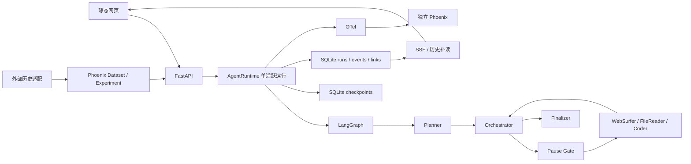

# 阶段 2：代码与环境审查——产品技术基线

最新用户方向见[产品方向](product-direction.md)；本报告保留阶段 2 的代码核查证据和暂定建议。

核查日期：2026-10-01；依据：[阶段 1 的 R01–R11 及验收场景](product-stage1-requirements.md)。本报告只审查与这些需求直接相关的代码和少量离线行为；不重新定义需求，也不是新架构方案或完整安全审计。

## 1. 简短结论

现有执行、checkpoint、分支血缘、事件补读和观测关联足以作为下一步交互设计的基础。产品主要缺口在于**把已有状态与证据投影成可读的步骤/分支视图**，并补足相应查询接口。另有一项本阶段确认的底层行为缺陷：模型调用阈值实际按 runtime 共享 gateway 累计，第二个任务可能继承前一个任务的消耗并提前失败。当前没有证据支持整体替换 LangGraph、Phoenix 或 WebSurfer；但它们均不是新产品不可替换的先验约束。

证据用语严格区分：发现代码 ≠ 运行验证；6项离线pytest、4项Node前端行为测试和2个临时目录定向脚本的通过范围见第7节。真实模型答题能力、浏览器动作、Phoenix接收及导师电脑部署**本阶段均未验证**。

## 2. 工作区与环境快照

| 项目 | 本阶段只读结果 |
|---|---|
| 路径 / 系统 | `C:\projects\m1-local-lab`；Windows NT `10.0.26200.0`（Windows 11 系列内核）；PowerShell 5.1.26100.9444 |
| 分支 / HEAD | `feature/full-project-audit-optimization` / `a808a04ca60d35e6e2d35ea46441d3ba6e662597` |
| 开始时Git状态 | 5份未跟踪文档：阶段1文档及既有 `advisor-demo-rehearsal.md`、`advisor-project-status.md`、`demo-walkthrough.md`、`windows-deployment-guide.md`；无已跟踪改动。阶段1摘要只提到4份，是因为阶段1文档当时尚未创建，属于时间差，不是文件丢失 |
| 适用指令 | 仓库、`docs/`和适用父目录均未发现 `AGENTS.md` |
| Python / 虚拟环境 | `.venv`、`.venv-phoenix`解释器均存在，均报告 Python 3.11.9；本阶段未运行`pip check`、重装或读取`.env` |
| 前端工具 | Node v24.21.0已安装；仓库前端是`web/index.html`、`app.js`、`style.css`静态文件，无`package.json`或构建锁；Node只用于现有前端行为测试 |
| 锁依赖 | `requirements-app.lock.txt`含LangGraph 1.2.11、Playwright 1.54.0、FastAPI 0.141.1；`requirements-phoenix.lock.txt`含Phoenix 11.35.0、FastAPI 0.116.2。两套环境隔离；版本来自锁文件，不代表本阶段重新核对所有已安装包 |

安装顺序和双环境见 [`scripts/install.ps1:5`](../scripts/install.ps1#L5)；应用与Phoenix分别由 [`start-app.ps1:1`](../scripts/start-app.ps1#L1)、[`start-phoenix.ps1:2`](../scripts/start-phoenix.ps1#L2)启动。旧报告的130 passed/2 skipped、同机隔离Windows部署和2026-09-20真实任务/Replay属于历史证据，本阶段未重跑。[审查报告](full-project-audit-optimization.md)、[演示回执说明](advisor-demo-rehearsal.md)。

## 3. 当前架构与真实执行路径

普通入口 [`cli.py:85`](../src/m1_local/cli.py#L85)以单worker启动API；[`api.py:67`](../src/m1_local/api.py#L67)创建runtime并在lifespan启动/关闭。POST新任务后，[`runtime.py:136`](../src/m1_local/runtime.py#L136)产生run/thread/branch，图以`durability="sync"`执行并逐节点保存真实checkpoint与关联，[`runtime.py:162`](../src/m1_local/runtime.py#L162)。实际图边见[`graph.py:299`](../src/m1_local/graph.py#L299)。WebSurfer使用官方`MultimodalWebSurfer`，但这里只作为一个worker；Coder生成`unexecuted_code`产物，不执行代码，[`graph.py:223`](../src/m1_local/graph.py#L223)。

API入口集中在[`api.py:113`](../src/m1_local/api.py#L113)至[`api.py:274`](../src/m1_local/api.py#L274)：首页、会话/健康、运行列表/详情/历史、暂停/恢复/回放/分叉、SSE/事件日志、产物和既有归因只读接口。**未发现取消单个运行的API**；runtime仅在应用关闭时取消后台任务，[`runtime.py:105`](../src/m1_local/runtime.py#L105)。一个runtime同一时间只准入一条运行，[`runtime.py:58`](../src/m1_local/runtime.py#L58)；跨进程锁覆盖metadata与checkpoint数据库，[`runtime_ownership.py:14`](../src/m1_local/runtime_ownership.py#L14)。

## 4. R01–R11 需求—实现—证据矩阵

证据等级名称沿用用户规定。若一行含多个子能力，只对**注明的已测范围**写“本阶段执行验证通过”；其余仍按代码/历史证据。处理方式是下一阶段候选，不代表已批准修改。

| 需求 | 现有实现位置 | 相关接口／数据 | 证据等级 | 缺口 | 建议处理方式 |
|---|---|---|---|---|---|
| R01 P0 本地安装与生命周期 | [`install.ps1:5`](../scripts/install.ps1#L5)、[`start-app.ps1:1`](../scripts/start-app.ps1#L1)、[`start-phoenix.ps1:2`](../scripts/start-phoenix.ps1#L2)、[`runtime.py:72`](../src/m1_local/runtime.py#L72) | 两环境、`/api/health`、Phoenix`/healthz`、SQLite所有权 | 存在历史测试记录；本阶段只读代码与解释器版本 | 双服务/双环境，需Key；无统一就绪/停止体验；导师实体电脑未验收 | 主要需要UI/交互改造；启动封装需局部接口/脚本工作 |
| R02 P0 新任务与费用边界 | [`api.py:27`](../src/m1_local/api.py#L27)、[`runtime.py:136`](../src/m1_local/runtime.py#L136)、[`web/app.js:943`](../web/app.js#L943) | POST`/api/runs`、run元数据、模型/文件/域名设置 | 本阶段执行验证通过：离线API任务创建；真实模型仅有历史记录 | 共享gateway计数导致跨任务提前耗尽阈值；WebSurfer内部调用不完全纳入此计数；没有严格金额预算 | **需要底层行为修复**，再做清楚的费用/能力提示 |
| R03 P0 Agent/工具步骤 | [`graph.py:85`](../src/m1_local/graph.py#L85)、[`graph.py:35`](../src/m1_local/graph.py#L35)、[`web/app.js:461`](../web/app.js#L461) | `node_started/finished`、`execution_id`、checkpoint state、span | 已发现代码实现，尚未执行完整步骤UI验证；历史真实运行记录 | 目前流程图按节点名汇总，重复调用同一节点会合并为“已完成”；无逐次输入输出面板 | 主要需要UI/交互改造，且需要接口或数据扩展 |
| R04 P0 答案与证据 | [`graph.py:172`](../src/m1_local/graph.py#L172)、[`graph.py:199`](../src/m1_local/graph.py#L199)、[`web/app.js:534`](../web/app.js#L534) | state的`progress_ledger/messages/citations/artifacts`；GET artifact | 本阶段执行验证通过：离线FileReader产出与去重；截图/引用仅历史记录 | 引用/产物与具体`execution_id`的统一查询缺失；“证据数”不计文件读取；部分原始输入在脱敏后不可见 | 需要接口或数据扩展，配合UI/交互改造 |
| R05 P0 控制动作 | [`runtime.py:290`](../src/m1_local/runtime.py#L290)、[`runtime.py:298`](../src/m1_local/runtime.py#L298)、[`runtime.py:334`](../src/m1_local/runtime.py#L334)、[`runtime.py:363`](../src/m1_local/runtime.py#L363) | POST pause/resume/replay/fork；run head和来源checkpoint | 本阶段执行验证通过：离线暂停、恢复、Replay/Fork及API规则；真实Replay为历史现场记录 | 页面控制依赖浏览器`confirm`；无单运行Cancel；外部动作不能精确回滚 | 可直接复用核心控制语义；控制提示主要需要UI/交互改造；取消需另定底层语义 |
| R06 P0 状态、事件、Trace | [`storage.py:39`](../src/m1_local/storage.py#L39)、[`runtime.py:441`](../src/m1_local/runtime.py#L441)、[`api.py:200`](../src/m1_local/api.py#L200)、[`web/app.js:227`](../web/app.js#L227) | GET detail/history/events-log、SSE、checkpoint_links、最新trace_id | 本阶段执行验证通过：历史与补读、4项Node前端行为；Phoenix接收未本阶段测试 | 仅暴露最新Trace；页面刷新不恢复选择；健康不证明Trace已被接收 | 主要需要接口或数据扩展及UI/交互改造 |
| R07 P0 可理解故障 | [`runtime.py:260`](../src/m1_local/runtime.py#L260)、[`api.py:131`](../src/m1_local/api.py#L131)、[`web/app.js:485`](../web/app.js#L485) | run状态/error、error事件、健康状态 | 已发现代码实现；历史测试记录；本阶段未验证完整故障UX | 失败/超时/恢复不确定时只显示状态或错误正文；`pausing`页面直接显示Pause Gate可误导当前执行位置 | 主要需要UI/交互改造；必要时扩展结构化错误数据 |
| R08 P0 新执行与导入历史 | [`dataset.py:21`](../src/m1_local/dataset.py#L21)、[`external_datasets.py:43`](../src/m1_local/external_datasets.py#L43)、[`attribution_read_model.py:307`](../src/m1_local/attribution_read_model.py#L307) | CLI JSONL新执行进run表；外部历史进Phoenix Dataset/Experiment，标记`imported_historical` | 已发现代码实现；存在历史测试记录；本阶段未重跑导入 | 两类入口分离，但产品没有统一的历史导入管理；新clone无研究数据 | 可直接复用来源隔离；需要接口或数据扩展和UI/交互改造 |
| R09 P1 分支比较 | [`storage.py:39`](../src/m1_local/storage.py#L39)、[`runtime.py:314`](../src/m1_local/runtime.py#L314)、[`runtime.py:363`](../src/m1_local/runtime.py#L363)、[`web/app.js:415`](../web/app.js#L415) | `parent_run_id/source_checkpoint_id`、branch/thread、history/event/checkpoint_links | 本阶段执行验证通过：兄弟分支独立head、旧分支继续；比较UI未实现 | 无比较查询/分支图；fork改动仅在事件与快照中，需推导；同节点多次执行不可按名字对齐 | 需要接口或数据扩展及UI/交互改造 |
| R10 P1 外部轨迹浏览 | [`external_datasets.py:151`](../src/m1_local/external_datasets.py#L151)、[`external_datasets.py:208`](../src/m1_local/external_datasets.py#L208)、[`attribution_read_model.py:197`](../src/m1_local/attribution_read_model.py#L197) | Dataset example/provenance；只读归因case详情 | 已发现代码实现；存在历史测试记录；本阶段未运行研究数据/接口 | 部分结构化payload省略、截断；一般用途轨迹浏览与合法数据初始化缺失 | 需要接口或数据扩展，先确认数据许可和展示范围 |
| R11 P1 日常导航与详情 | [`web/index.html:20`](../web/index.html#L20)、[`web/app.js:195`](../web/app.js#L195)、[`web/app.js:590`](../web/app.js#L590)、[`web/app.js:643`](../web/app.js#L643) | 左侧run列表、事件/证据/checkpoint/State标签 | 已发现代码实现；本阶段4项Node行为测试通过，未做浏览器视觉验收 | raw JSON与ID突出；选历史checkpoint仅显示摘要，State仍是当前head；选择不持久化 | 主要需要UI/交互改造，步骤详情需接口或数据扩展 |

R12（P2）是冻结归因资产保留要求，当前代码在`attribution*.py`、`external_export.py`和既有研究文件中；本阶段**不审查归因算法效果、不重跑30×3，也不迁移或删除它**。阶段3设计需保留来源边界，不能把已有离线预测当作新任务的自动诊断能力。

## 5. 核心操作、身份与数据关联

### 标识和位置

| 标识 | 实际含义及生成/复用 | 持久化或展示位置 |
|---|---|---|
| task | 用户问题文本，没有独立`task_id`实体；Dataset CLI另有`dataset_case_id` | run表`task`和图state；[`storage.py:39`](../src/m1_local/storage.py#L39) |
| run_id | 新任务、Replay、Fork各生成新ID；Resume沿用原ID | run表主键，事件、执行链接及产物路径引用；[`runtime.py:136`](../src/m1_local/runtime.py#L136)、[`runtime.py:334`](../src/m1_local/runtime.py#L334) |
| thread_id | 新任务新ID；Replay/Fork沿用来源thread | LangGraph可配置键及run表；分支共享一个thread，[`runtime.py:136`](../src/m1_local/runtime.py#L136) |
| branch_id | 新任务、Replay/Fork各自新ID；Resume复用 | run表、state、span、产物目录；[`runtime.py:334`](../src/m1_local/runtime.py#L334) |
| execution_id | 每次节点进入时新UUID；重复访问同一节点有不同ID | `node_started/finished`、checkpoint_links、span属性、progress/message ID；[`graph.py:35`](../src/m1_local/graph.py#L35) |
| checkpoint_id | LangGraph真实快照ID；非任意UI事件/点击 | run`head_config`、历史快照、`checkpoint_links`输入/输出；[`runtime.py:314`](../src/m1_local/runtime.py#L314) |
| trace_id | 每次`_execute`建立观测根上下文；Resume可让同一run有多个Trace | checkpoint_links按execution关联；当前API只查询**最新**非空ID，[`storage.py:159`](../src/m1_local/storage.py#L159) |

新任务分配三个身份并从START执行。暂停请求把run标为`pausing`，在后续`pause_gate`的安全边界消费；Resume从该run持久化`head_config`继续，有interrupt则用`Command(resume=True)`，否则以空输入续跑，[`runtime.py:290`](../src/m1_local/runtime.py#L290)、[`runtime.py:298`](../src/m1_local/runtime.py#L298)。Replay/Fork先沿来源run的head祖先链寻找**指定checkpoint**，拒绝未初始化或终结快照，再从该完整config创建新head和新run/branch；Fork先为`paused`，仅允许修改`plan`、`worker_instruction`，是应用白名单而非框架天然限制，[`runtime.py:314`](../src/m1_local/runtime.py#L314)、[`runtime.py:389`](../src/m1_local/runtime.py#L389)。来源run和checkpoint存于run表；修改值存于`fork_created`事件及新快照，没有独立结构化diff表。

每条run保存独立`head_config`，`history()`从其head沿`parent_config`读取，包含分叉前共享祖先；旧head不会随新分支移动。`append_unique`按记录ID去重已有messages、progress与artifacts，[`state.py:6`](../src/m1_local/state.py#L6)；新节点execution_id不同，重复执行产生新记录，不能将其自动等同于错误重复。旧产物随state继承且文件仍在原run/branch目录；API按当前state中的artifact ID授权读取，[`api.py:274`](../src/m1_local/api.py#L274)。本阶段临时验证了“先建两个兄弟Fork，再恢复较早一个”，两个分支仍独立；这不是任意异常/并发下的正确性证明。

**恢复精度**是LangGraph节点边界。WebSurfer重建新浏览器、按保存URL再访问，不能恢复DOM、JS内存、登录态、表单或外部副作用，[`websurfer.py:103`](../src/m1_local/websurfer.py#L103)、[`websurfer.py:162`](../src/m1_local/websurfer.py#L162)。已完成run不可Resume；failed/interrupted/paused可尝试从head继续，但失败后外部动作是否已提交可能不确定。没有公开的单run Cancel；进程关闭时的内部取消不是产品取消能力。

### 界面数据与复原限制

GET`/api/runs/{id}`返回**当前head**状态和最新trace_id；GET`.../history`返回历史快照的完整`state/config/next/metadata`，但前端选择历史checkpoint只显示ID、时间、next、状态、步数等字段，[`web/app.js:617`](../web/app.js#L617)；“State JSON”始终渲染`ui.current`即当前head，[`web/app.js:643`](../web/app.js#L643)。因此**数据可读，现有UI没有真正的历史步骤检查器**。`node_started/finished`事件主要给节点名、execution_id和少量路由信息，工具输入输出需从相邻快照、progress/messages及观测摘要推导；`checkpoint_links`没有独立GET。节点span的`input.value/output.value`是脱敏摘要，不可当完整原始输入输出，[`graph.py:64`](../src/m1_local/graph.py#L64)、[`observability.py:103`](../src/m1_local/observability.py#L103)。若要做步骤详情，需明确新的安全投影和“未记录/已脱敏”的空态。

对齐分支应优先使用`source_checkpoint_id`、`parent_config`祖先链及`execution_id`/checkpoint link，而非节点名或`step_count`。当前流程图用完成过的节点名集合着色，[`web/app.js:466`](../web/app.js#L466)，循环重规划或多次WebSurfer调用会合并。事件SQLite自增ID、按run过滤；SSE断线按ID补读，前端按ID去重并在切换run时关闭旧流，[`storage.py:136`](../src/m1_local/storage.py#L136)、[`web/app.js:303`](../web/app.js#L303)、[`web/app.js:325`](../web/app.js#L325)。刷新页面后`ui.currentRunId`从null初始化，不自动重选；这只丢前端选择，不重跑任务，[`web/app.js:28`](../web/app.js#L28)。

### 数据集与观测边界

[`dataset.py:21`](../src/m1_local/dataset.py#L21)的JSONL执行器串行创建真实本地run、独立thread并要求显式`limit`；可能调用模型/Worker。[`external_datasets.py:43`](../src/m1_local/external_datasets.py#L43)把Who&When/TraceElephant历史转为Phoenix Dataset内容，标明`imported_historical`、`external_task_executed=false`；只读归因页面消费已有Experiment，不创建LangGraph可恢复checkpoint，[`attribution_read_model.py:307`](../src/m1_local/attribution_read_model.py#L307)。两类记录目前是**两个产品入口/存储域**；外部历史没有运行控制API。原始步骤可被截断和安全摘要化，新clone无既有研究数据库。

Phoenix不可用时观测初始化记录warning而不阻止主任务；`/api/health`重新检查Phoenix首页，能说明服务可达，却**不能证明该run的span已被接收**，[`observability.py:128`](../src/m1_local/observability.py#L128)、[`api.py:131`](../src/m1_local/api.py#L131)。主页面可直接读本地事件、checkpoint、运行状态和**最新**Trace ID；完整Span/多Trace列表目前依赖独立Phoenix页面或新增安全查询。事件与Trace不是一一对应，也不能把本地事件误写为Phoenix已持久化的证据。

## 6. 问题清单与影响

| 等级 | 证据与最小复现 | 产品影响 | 处理建议 |
|---|---|---|---|
| **P0 已证实缺陷：跨任务模型计数** | [`models.py:43`](../src/m1_local/models.py#L43)的gateway实例计数、[`graph.py:122`](../src/m1_local/graph.py#L122)直接比较全局`calls`。本阶段独立临时库设`max_model_calls=4`，连续两个同样的允许CSV任务：首条completed、计数4；第二条planner后计数5，orchestrator直接走上限，状态failed | 后续新任务可能无故失败；State里的调用数也不是可靠的单run费用指标 | 实现阶段先建立每run/每次执行预算语义和测试；WebSurfer内部调用另单独计量。不得以UI掩盖该问题 |
| **P1 已证实产品数据缺口：步骤检查** | [`api.py:200`](../src/m1_local/api.py#L200)仅head详情、[`api.py:215`](../src/m1_local/api.py#L215)原始完整history；[`web/app.js:617`](../web/app.js#L617)选中checkpoint只渲染摘要。无execution link GET | R03/R04/R11难以在一处查看“这一步实际输入、输出、证据、状态” | 建安全的步骤投影及execution→checkpoint/artifact关联查询，明确脱敏与未记录字段 |
| **P1 已证实产品数据缺口：多Trace** | [`storage.py:159`](../src/m1_local/storage.py#L159)只取run最新trace；[`api.py:200`](../src/m1_local/api.py#L200)只返回一个ID | 同run恢复后旧Trace难找，完整因果链被隐藏 | 增加按run列出Trace/执行区间与接收状态的查询；不要把最新ID解释成唯一ID |
| **P1 已证实交互缺口：分支比较** | run保存父run/来源checkpoint，[`storage.py:39`](../src/m1_local/storage.py#L39)；当前列表只写“分支/回放”，[`web/app.js:195`](../web/app.js#L195) | 无共同祖先、修改点和后续结果对照；重复节点名可能误对齐 | 复用现有血缘，补结构化diff/分支概要接口与UI；按checkpoint/execution对齐 |
| **P1 已证实显示误导：pausing位置** | [`web/app.js:443`](../web/app.js#L443)一见`pausing`就返回`pause_gate`；后端[`storage.py:169`](../src/m1_local/storage.py#L169)请求时即改状态，真正pause需等后续gate | 页面可能把仍在执行的Planner/Worker显示为已到暂停边界 | 区分“暂停请求已提交”“当前实际节点”“已暂停”三种状态 |
| **P1 已证实能力缺口：单run取消** | [`api.py:192`](../src/m1_local/api.py#L192)至[`api.py:274`](../src/m1_local/api.py#L274)无取消路由；[`runtime.py:105`](../src/m1_local/runtime.py#L105)只有shutdown内部取消 | 用户不能停止卡住的单条任务，只能等待超时或停止服务 | 阶段3先设计状态/外部副作用/确认语义；如列为P0再作底层实现与测试 |
| **P1 已证实边界：浏览器不可回滚** | [`websurfer.py:103`](../src/m1_local/websurfer.py#L103)显式重建并重访URL；checkpoint是super-step | 不能承诺每次点击可回溯，也不能撤销网页副作用 | 在控制UI写明恢复粒度；若导师要求点击级恢复，需单独可行性验证 |
| **P1 已证实部署/来源缺口** | 两个启动脚本、两个环境；外部历史只在预备Phoenix实例，见[`windows-deployment-guide.md:71`](windows-deployment-guide.md#L71) | 新电脑打开的主界面可能空，无法自然演示研究历史；首次就绪路径复杂 | 设计单入口/就绪向导与获准的样例初始化流程；不要随源码打包原始数据 |
| **P2 已证实体验缺口：刷新丢选择、原始JSON** | [`web/app.js:28`](../web/app.js#L28)、[`web/app.js:643`](../web/app.js#L643)；本阶段代码阅读，先前现场已复现刷新回初始视图 | 演示中断，用户误以为回放运行消失 | 保存选中run/标签的导航状态，优先摘要，原始JSON按需展开 |
| **风险建议，未证实为本阶段缺陷：外部动作限制** | [`websurfer.py:112`](../src/m1_local/websurfer.py#L112)提示不登录/表单/上传，导航仍有URL校验；本阶段未运行越权场景 | 安全宣称范围有限 | 后续按具体风险做隔离测试；不在本阶段推断已发生越权 |

建议更正阶段1：R02把“模型调用限制”描述为配置阈值是对的，但应补充**目前阈值跨任务累计、会提前拒绝新任务**；R06的“最新Trace关联”不能推导为完整多Trace浏览；R05的“暂停/恢复/回放/分叉”应与缺失的单run取消分开。阶段1原文保持不变，本报告给出证据修订。

## 7. 本阶段有限验证

执行前检查了[`tests/conftest.py:10`](../tests/conftest.py#L10)：`tmp_path`分别给metadata/checkpoint/artifacts/Phoenix工作路径，显式`_env_file=None`和空Key；目标pytest注入`RuleBasedGateway`且`enable_tracing=False`，不启动WebSurfer或真实服务。Node测试用`vm`和模拟EventSource，不请求网络。两段一次性脚本只在`tempfile.TemporaryDirectory`内写合成CSV与SQLite，结束后自动关闭；没有读取`data/`或研究资产。

| 目的 | 命令/方法 | 平台与结果 | 证据范围 |
|---|---|---|---|
| 分支独立、历史不触发模型、暂停重启、Replay血缘、SSE 501条补传、API控制规则 | `.venv\Scripts\python.exe -B -m pytest -q -p no:cacheprovider --tb=short` 加6个定向用例：`test_file_task_persists_history_and_does_not_duplicate`、`test_fork_preserves_old_head_and_whitelists_changes`、`test_background_admission_is_atomic_and_pause_survives_restart`、`test_replay_creates_lineage_without_moving_original_head`、`test_partial_sse_drains_multiple_pages_then_closes`、`test_control_endpoints_follow_runtime_status_and_checkpoint_rules`；进程临时设置空Key、禁真实模型与LangSmith | Windows/Python 3.11.9；**6 passed，25.78s，exit0** | 仅临时数据库、RuleBased路径；不验证真实模型/WebSurfer/Phoenix接收 |
| 前端历史分页、SSE transport error、切换run竞态、终态补读 | `node --test tests/frontend_behaviors.cjs` | 沙箱内子进程`spawn EPERM`，同一命令获准沙箱外重试后 **4 passed，exit0** | Node VM模拟；不是Chromium视觉或真实服务验收 |
| 多兄弟分支恢复 | 一次性Python脚本：临时库，原运行→同一源快照Fork两个兄弟→恢复较早分支→分别读取head与state | Windows/RuleBased：较早分支completed且run/branch身份正确；较新分支仍paused且head不变；原head不变 | 本次边界样例通过；不证明所有并发/崩溃场景 |
| 验证共享模型计数 | 一次性Python脚本：临时库、同一runtime、`max_model_calls=4`，连续提交两个相同允许CSV任务 | 首条completed、gateway累计4；第二条仅planner→orchestrator→finalizer，状态failed、累计5；**缺陷复现** | 规则替身复现控制逻辑，不涉及付费模型或外部网页 |

**未执行**：完整pytest、`pip check`、真实Chromium、应用/Phoenix服务启动、OTLP实际接收、安装、网络/付费模型、真实WebSurfer、benchmark、归因算法实验、另一台电脑验收。缺少本阶段新证据的项目不能标成“本阶段通过”。

## 8. 有限改造范围比较与暂定建议

| 范围 | 目标覆盖 | 开发量级 | 迁移风险 / 本地部署 / 可测试性 / 维护 |
|---|---|---|---|
| **A 保留主要后端，重做信息组织并补接口** | 直接利用运行、checkpoint、血缘、事件和artifact；解决R03/04/06/09/11；同时单独修复共享计数缺陷 | 中 | 数据不迁移或最少迁移；双服务/双环境仍需封装；可用现有临时库测试验证投影；避免维护第二套执行引擎 |
| **B 保留已验证执行与存储，局部重做控制/关联层** | 在A基础上处理取消、复杂恢复、统一步骤/Trace索引和更强启动体验 | 中到高 | 需定义旧运行兼容与中途失败迁移；部署可改善但引入控制状态复杂度；需更多故障注入测试与维护 |
| **C 替换关键底层组件** | 只有在导师明确要求超出节点checkpoint的恢复粒度、或A/B定向原型证明现有组件难以满足时才有目标 | 高 | 会失去现有checkpoint、分支、OTel关联与Windows验收资产；数据迁移、真实浏览器与跨进程恢复必须重新证明；短期部署/维护成本最高 |

**暂定推荐A，保留B的升级路径；目前不建议启动C。** 已证实的共享计数缺陷可在当前gateway/运行边界修复；步骤与分支可由现有快照/事件/链接扩展安全读模型解决。尚无证据表明必须替换LangGraph、Phoenix或WebSurfer才能达到R01–R11。若阶段3提出浏览器点击级恢复、强取消或完全内嵌观测等新硬要求，先用限定原型证明现有组件的障碍，再评估C，并明确失去的迁移资产。前端继续原生文件还是引入构建链，应按交互复杂度和Windows安装代价比较，不按个人偏好决定。

## 9. 阶段3交互设计交接

- **可围绕真实能力设计**：任务创建、运行历史、持久事件、合法checkpoint选择、Pause请求与Resume、Replay新运行、Fork暂停分支、父运行/来源快照、引用/截图/产物、Phoenix入口、外部历史来源标识。设计稿要区分动作可用/正在请求/完成/失败及可能费用。
- **只宜做标明样例数据的原型**：完整分支并排比较、单步骤完整输入输出、跨多Trace聚合、外部轨迹原始payload浏览、自动错误诊断、第一次安装时内置真实研究案例。它们有数据或接口缺口；示例不得冒充已实现产品。
- **先解决的技术疑问**：共享gateway计数的run/execute预算归属；安全的步骤投影与证据关联；多Trace查询和接收确认；Fork改动持久表示；单run取消是否为验收硬需求；导师是否要求点击级WebSurfer回溯；研究数据展示许可与初始化方式。
- **当前不能承诺的界面行为**：任意一步可恢复、外部网页副作用回滚、所有Agent输入输出原文可见、主界面已有完整Span、多任务并行、自动归因新任务、无Key执行真实模型、严格美元费用上限、跨电脑部署已PASS。

阶段2到此结束。建议阶段3先用信息结构和交互流程验证A范围的产品体验，再授权具体实施；本报告不自行启动设计或代码迁移。
